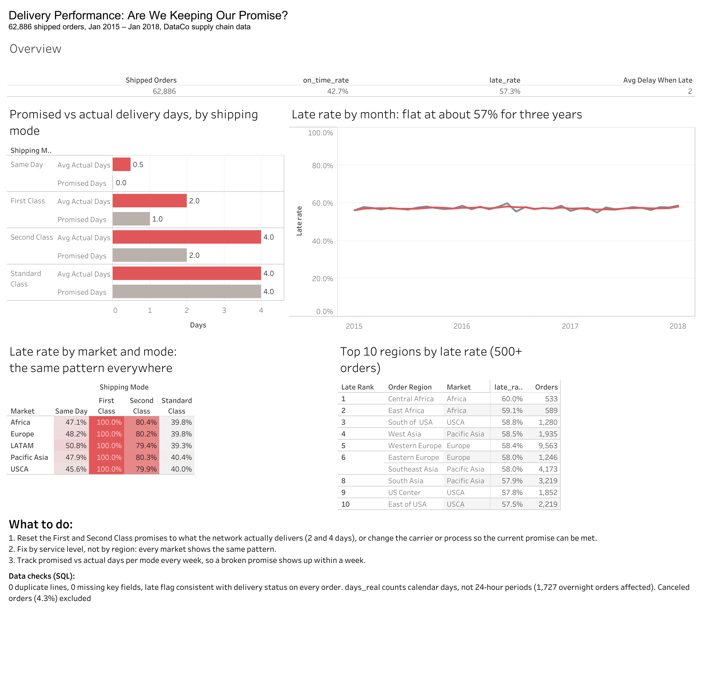

# Logistics Delivery Performance: SQL + Tableau

A logistics KPI report built on 65,741 orders (180,508 order lines, Jan 2015 – Jan 2018) from the public DataCo Smart Supply Chain dataset. SQL in SQLite does the data-quality checks and the KPI calculations; a Tableau Public dashboard presents them on one page.

**[View the interactive dashboard on Tableau Public](https://public.tableau.com/views/DeliveryPerformanceLogisticsKPIAnalysis/DeliveryPerformance)**



**The question:** are deliveries on time, and if not, where should a logistics team act first?

## Key findings

| Shipping mode | Promised days | Actual days (avg) | Late orders |
|---|---|---|---|
| Same Day | 0 | 0.5 | 48% |
| First Class | 1 | 2.0 | **100%** |
| Second Class | 2 | 4.0 | **80%** |
| Standard Class | 4 | 4.0 | 40% |

1. **57% of shipped orders arrive late**, and the rate is flat over all 37 months, so this is a structural problem rather than a seasonal one.
2. **The premium modes break their promise most often.** Every First Class order is late, always by exactly one day, and 80% of Second Class orders are late by one to four days.
3. **Geography explains almost nothing.** All five markets fall between 56.5% and 57.7% late. The mode effect is the same in every market (see `kpi05_mode_by_market`).
4. **Revenue at stake:** about 4.9M (100%) of First Class revenue and 4.9M (80%) of Second Class revenue is tied to late deliveries.

## Recommendations

1. **Re-set the First and Second Class promises to what the network delivers** (2 and 4 days), or change carrier/process so the current promise can be met. Today customers pay for a premium that is never delivered.
2. **Fix by service level, not by region.** Market-level interventions would miss the cause, because every market shows the same pattern.
3. **Add a promise-vs-actual KPI per mode to the weekly dashboard** so a broken promise is visible within a week rather than after three years of data.
4. **Ask the data owner how `days_real` is measured.** The data-quality checks show it counts calendar days, not 24-hour periods (see below). That definition should be documented wherever on-time is reported.

## Data-quality checks (`sql/01_data_quality.sql`)

All checks passed except one definition question:

- No duplicate order lines, no missing key fields, no impossible values (negative days, delivery before order).
- All lines of an order agree on mode, status and dates, so rolling up to one row per order is safe.
- The late flag matches the delivery status for every order.
- Each mode has exactly one promised lead time.
- **`days_real` counts calendar days**: 1,727 orders delivered 12 hours after ordering, overnight, count as 1 day. Against calendar days there are 0 mismatches; against 24-hour periods, 1,727.
- 4.3% of orders were canceled or flagged as suspected fraud. They never shipped and are excluded from all delivery KPIs.

## Project structure

```
load_data.py               CSV -> SQLite (drops customer names, e-mail, password, street)
sql/01_data_quality.sql    9 data-quality checks
sql/02_logistics_kpis.sql  8 KPI queries (CTEs, window functions, RANK)
run_queries.py             runs every query, saves output/<name>.csv
output/                    query results, imported by Tableau
dashboard.png              screenshot of the Tableau dashboard
```

## How to run

```bash
pip install pandas
python load_data.py path/to/DataCoSupplyChainDataset.csv
python run_queries.py
```

The dashboard was built in Tableau Public from the CSVs in `output/` (one data source per file, with calculated fields for percentages and the month date).

## Data

DataCo SMART SUPPLY CHAIN FOR BIG DATA ANALYSIS, Constante, Silva and Pereira (2019), Mendeley Data, DOI [10.17632/8gx2fvg2k6.5](https://data.mendeley.com/datasets/8gx2fvg2k6/5). Also on Kaggle. The raw data is not included in this repository; download it from the source.

## Limitations

- **The data looks simulated.** Delays within each mode are spread almost exactly evenly (for example, Second Class: 20% each at 0, 1, 2, 3 and 4 days late). Real logistics data rarely looks like this. The findings show the method, not real carrier performance.
- No carrier, warehouse or route fields, so root causes beyond shipping mode cannot be tested.
- The data ends in January 2018.
